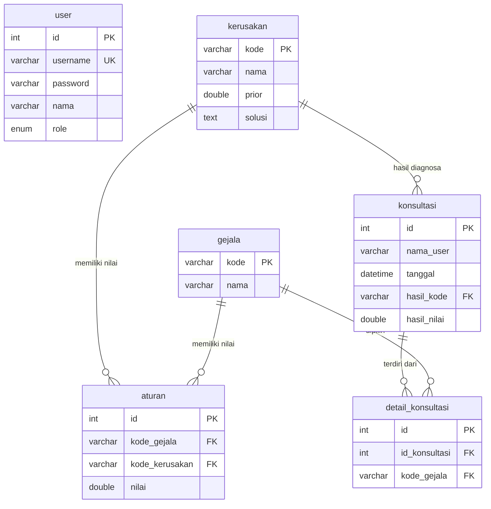

# ERD (Entity Relationship Diagram) — Sistem Pakar Diagnosa Kerusakan Laptop

## Entitas & Relasi

| Tabel              | Relasi                                    | Keterangan                                    |
|--------------------|-------------------------------------------|-----------------------------------------------|
| user               | —                                         | Admin / pakar (login).                        |
| kerusakan          | 1 ─── M aturan   (kode_kerusakan)         | Satu kerusakan muncul di banyak aturan.       |
| gejala             | 1 ─── M aturan   (kode_gejala)            | Satu gejala muncul di banyak aturan.          |
| aturan             | M:1 kerusakan, M:1 gejala                | Nilai P(gejala\|kerusakan) — tabel pivot.     |
| konsultasi         | M:1 kerusakan (hasil_kode, boleh null)   | Hasil diagnosa utama tiap konsultasi.         |
| detail_konsultasi  | M:1 konsultasi, M:1 gejala               | Gejala yang dipilih pada tiap konsultasi.     |

## Catatan Kardinalitas

- `aturan` adalah relasi many-to-many antara `gejala` dan `kerusakan`,
  dipecah menjadi tabel perantara dengan atribut `nilai` (P(gejala|kerusakan)).
- `konsultasi` menyimpan hasil diagnosa utama (`hasil_kode`, `hasil_nilai`);
  `detail_konsultasi` menyimpan gejala spesifik yang dipilih user.
- `hasil_kode` pada `konsultasi` boleh NULL (ON DELETE SET NULL), sehingga
  riwayat tetap ada meski data kerusakan dihapus.

## Skema Lengkap (ringkas)

Lihat `sql/schema.sql` untuk definisi DDL lengkap (PRIMARY KEY, FOREIGN KEY,
UNIQUE KEY, ENGINE=InnoDB, charset utf8mb4).