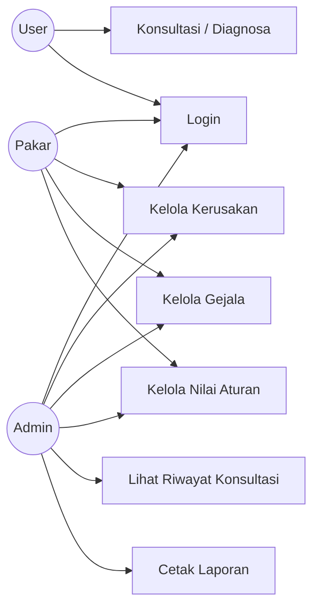

# Use Case Diagram

## Aktor

| Aktor | Deskripsi |
|-------|-----------|
| User  | Pengguna umum yang melakukan konsultasi diagnosa kerusakan laptop. |
| Admin | Mengelola seluruh data master (kerusakan, gejala, nilai aturan) dan laporan. |
| Pakar | Memvalidasi/memperbarui nilai probabilitas basis pengetahuan. |

## Deskripsi Use Case

| Kode | Nama | Aktor | Deskripsi |
|------|------|-------|-----------|
| UC1 | Konsultasi / Diagnosa | User | Memilih gejala, sistem menghitung Teorema Bayes, menampilkan hasil + solusi. |
| UC2 | Login | User, Admin, Pakar | Otentikasi username & password (PBKDF2-SHA256). |
| UC3 | Kelola Kerusakan | Admin, Pakar | CRUD data kerusakan (kode, nama, prior, solusi). |
| UC4 | Kelola Gejala | Admin, Pakar | CRUD data gejala (kode, nama). |
| UC5 | Kelola Nilai Aturan | Admin, Pakar | Mengisi/mengubah nilai P(gejala|kerusakan). |
| UC6 | Lihat Riwayat Konsultasi | Admin | Melihat daftar konsultasi yang tersimpan. |
| UC7 | Cetak Laporan | Admin | Mencetak laporan riwayat konsultasi. |